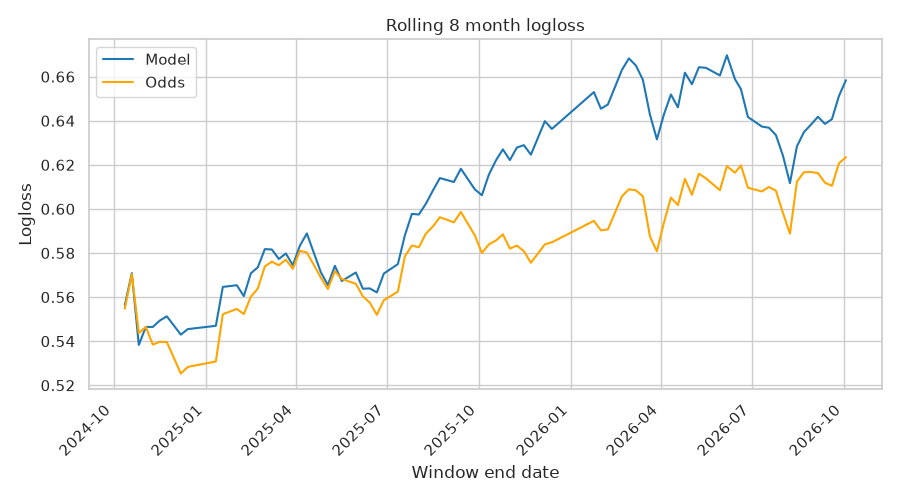

# mma_model
A model to predict MMA fight results.

Everything runs inside Docker.

# What's where

- `mma_functions/` is the package holding all the model code. It is grouped by topic: `scraping`, `parsing`, `odds_scraping`, `cleaning`, `dataset`, `features`, `elo`, `odds`, `betfair`, `modelling`, `evaluation`, `tracking` and `utils`. `pipelines.py` holds the functions that drive a whole stage and are allowed to reach into everything else. `config.py` loads the yaml files from `configs/`.
- `pipeline/` is the numbered scripts, one per stage, run in order. They should stay thin and just call into `mma_functions`.
- `configs/` is the yaml config. Import what you need from `mma_functions.config`, e.g. `from mma_functions.config import config, elo_config`.
- `tests/unit_tests/` is the pytest suite. `tests/data/` holds the expected outputs the tests compare against.
- `data/`, `models/` and `results/` are outputs, with the datasets tracked in DVC.
- `secrets/` holds the Betfair certificate pair, `client-2048.crt` and `client-2048.key`. Everything under it is gitignored.

Three things are gitignored, so a fresh clone doesn't have them and nothing will run until they exist:

- `configs/betfair_login_config.yaml` with `username`, `password`, `delay_feed_app_key`, `live_feed_app_key` and `certs_location` set to `./secrets/betfair_certs`.
- `secrets/betfair_certs/` with the certificate pair. Generate it with `openssl req -x509 -newkey rsa:2048 -nodes -days 3650 -subj "/CN=betfair" -keyout client-2048.key -out client-2048.crt` and upload the `.crt` to Betfair. Keep those two filenames, betfairlightweight looks for them by name and takes the folder rather than the files.
- `.dvc/config` with the Backblaze keys, see the DVC setup section below.

One thing that catches you out: modules inside `mma_functions` refer to each other as `from mma_functions import odds` and then `odds.calculate_true_odds(...)`, rather than importing the function directly. There are circular references between the modules and the direct form fails on those. Tests and scripts sit outside the cycle so they can import functions by name as normal.

# Monitoring

`pipeline/17_model_monitoring.py` scores the out of time sample with each model version and logs it to the `Model_Monitoring_v2` experiment. Metrics are broken down by weightclass, year, month, time format, fighter history and date, and two of the artifacts are aimed at drift specifically.

The rolling logloss chart is the trailing 8 month logloss at each fight date, with the model and the odds plotted together. That pairing is the point of it: if both lines rise then the fights got harder to call and the model is fine, if only the model's line rises then it has drifted. The window length is set at the top of the script.



That chart is an example showing model drift from one run rather than a live figure, the current numbers are in MLflow.

The logloss by method and period table splits the sample either side of a date and breaks it down by method of victory, so I can ask whether one kind of fight got harder rather than just whether the whole thing got worse. The odds columns do the same job here.

Draws and no contests are excluded from the monitoring sample. A bet on one is voided and the stake comes back, so they have no bearing on whether the model makes money, and the model gives them so little probability that each one costs around five times what an ordinary fight does in logloss. Four of the eight in the sample fell in the decision group, one before the August 2025 split and three after, and that alone made decisions look like they had degraded by 0.49 when the figure without them is 0.01. They are only excluded from monitoring, training is unchanged.

Windows and breakdown cells below a minimum sample size get dropped rather than reported, because a logloss on three fights says nothing and it distorts the chart it sits in.

# Docker

There are two Dockerfiles:

- `Dockerfile` is the CPU image. Python 3.11 slim with everything in `requirements.txt` plus chromium and xvfb for the scrapers. Builds on Windows and on the Raspberry Pi.
- `Dockerfile.cuda` is the GPU image for training on the Nvidia card. Windows only.

Build from the repo folder:

```
docker compose build
docker build -f Dockerfile.cuda -t mma_model-cuda .
```

Compose only covers the CPU image. The GPU one is still built and run by hand.

Only `requirements.txt` goes into the image. The repo itself is bind mounted at `/workspace` at runtime so the container always sees the working copy. The code also depends on `ablinston-ml`, which lives in a sibling folder on the host. It isn't in the image either. It gets mounted at `/opt/ablinston-ml` and installed as editable so changes to it show up without reinstalling.

Two editable installs are needed in the container, not one. `mma_functions` is a package now, so the repo itself has to be installed as well or nothing can import it:

```
pip install -e /workspace
pip install -e /opt/ablinston-ml
```

Both of those are in the service `command` in `compose.yaml` so they happen on every start. They go into the venv inside the container rather than onto the mount, so they are lost whenever the container is recreated, and doing them every time means they come back without me having to remember.

## Running it

```
docker compose up -d
docker compose exec mma_model bash
```

`up -d` builds the image if it is missing, creates the container with both mounts, does the installs and leaves it sitting there. After that `exec` is how you get a shell. `docker compose down` stops and deletes the container, and the next `up -d` puts it all back.

If it won't stay up, `docker compose logs mma_model` says why. Normally it is a failed `pip install -e`, which kills the command before it reaches the `sleep`.

Adding a mount is a line under `volumes:` and then `docker compose up -d` again, which recreates the container for you. After a change to `requirements.txt` use `docker compose up -d --build`.

The VS Code dev container in `.devcontainer/` points at the same compose file, so it gets the same mounts and the same installs. It doesn't build or mount anything of its own now.

For the GPU image add `--gpus all` to a plain `docker run`.

Scripts are run from `/workspace`, e.g. `python pipeline/16_predict_future_events.py`. They have to be run from there because the paths to `data/` are relative to it.

## Raspberry Pi

The Pi needs the 64 bit Raspberry Pi OS. There are no 32 bit wheels for polars, pyarrow or xgboost so a 32 bit OS tries to compile them from source and fails. The image built on the Pi is arm64 and the one built on Windows is amd64, so they can't be copied between the two. Each machine builds its own from the same Dockerfile. This is slow on the Pi, 20 minutes or so, but only needed when `requirements.txt` changes.

# Updating training data

The full data scrape code is found in the `pipeline` folder. Scripts 1, 2 and 3 will perform a full scrape of the data and all fighters stats.

Once this has been done, script 4 can be run to add new events and fighter stats to the existing data. **To update, only script 4 needs to be run.**

# Bayesian Beta Binomial: The Zero Division Solution

When calculating success rates (like submission accuracy or strike accuracy), we use Bayesian Beta Binomial analysis to provide meaningful priors that smoothly handle edge cases.

The approach works like this: Instead of naive division that breaks on zeros, we model each ratio as a Beta distribution where:

```
α (alpha) represents successful attempts plus prior successes
β (beta) represents failed attempts plus prior failures
The posterior mean (α / (α + β)) gives us our smoothed estimate
```

For example, with submission accuracy:

`submission_accuracy = (submissions + α) / (submission_attempts + α + β)`

α is the total submissions from the last n fights and α + β is the total attempts at submissions. In my functions, these are scaled by a factor called `bayes_alpha_plus_beta_rebase` for both per minute stats and percentage stats. This is to stop them dominating the formula. They will be rebased to a number of total attempts or minutes depending on what's being calculated.

For example, if there are 100 submission attempts across 1000 minutes in the history, this could be rebased to give α = 1, α + β = 10.

## Unit testing

The unit tests live in `./tests/unit_tests/`. Run `pytest` from `/workspace` and it picks them up, the paths are set in `pytest.ini`. Don't run it from inside the test folder, the tests load their expected outputs from `./tests/data/` relative to the repo root.

# Training experiments

These use MLflow. The server runs on the host, not in the container. Start it with `run_mlflow_server.bat` on Windows or `run_mlflow_server_raspberry_pi.sh` on the Pi. Both clear out the MLflow trash first, then serve on port 8080. The mlflow version on the host needs to match the one pinned in `requirements.txt` or the client and server disagree.

The scripts point at `http://127.0.0.1:8080`. Inside a container that address is the container itself, not the host, so either run the container with `--network host` (works on the Pi) or point the scripts at `host.docker.internal` on Windows.

## Metric choice

I chose logloss to assess the models and target rather than accuracy. Although we are only interested in predicting the winners, if we want to make money then the odds/probability of each outcome is the most important thing to get correct.

# GPU

Training of models runs much faster on GPU than CPU. There is a test script in the tests folder to verify this.

The experiments run with GPU on an Nvidia GTX 1060 using `Dockerfile.cuda` and xgboost. Run the container with `--gpus all`. Docker Desktop passes the card through from WSL2, so as long as the Nvidia driver is installed on Windows nothing else is needed.

I never got GPU training with LightGBM working on Windows, so xgboost is used instead (for random forests too, because it allows GPU training).

# Notes

To undo stupid split in Spyder, use Alt + Shift + W

## Debugging with pdb

At a `pdb.set_trace()` prompt, list comprehensions and lambdas can't see local variables. You get a NameError even though `p name` prints it fine. This is because pdb execs your input with separate globals and locals and the comprehension is a new scope that only sees the globals. Type `interact` to drop into a normal Python shell in the same frame where it all works, Ctrl-D to get back.

## Odds

Decimal odds are how much is received back for every 1 bet. So for example 2 means you receive 2 (original bet + 1 profit)

## Betfair API

The Betfair API is accessed through the `betfairlightweight` python package. It is relatively complex to navigate with little documentation.

Betfair historical data needs to have packages purhcased manually on the website https://historicdata.betfair.com/#/home. Seems to be just needed on a calendar month basis which will then allow files to be downloaded during that month.

Historic data has too many files so better to download online then extract the bz2 files.

MMA is lumped with everything else so the scripts scan the files and see which ones are fights. Each file is a `market` which is the market for a specific outcome e.g. Fight Result for Conor vs Khabib. The package creates `MarketBook`s which are the details of a market, and `RunnerBook`s which are betting on a specific outcome e.g. Conor to win.

## Playwright

To install, need to install the package then install the browsers with `python -m playwright install
` 

# DVC setup

dvc and dvc-s3 are in `requirements.txt` so they're already in the image. Set up, using Backblaze (https://secure.backblaze.com/b2_buckets.htm) with S3 is a bit of a nightmare. Some versions of aiobotocore and botocore didn't push properly, so if pushes start failing after bumping packages those are the first ones to suspect.

Had a common issue with a '128m' error. If this happens go in the .git/config file and comment out the limits in the `[pack]` section.

Then need to set up the remote. I have called it `storage`.

```
dvc remote add -d storage s3://mma-model-lite
dvc remote modify storage endpointurl https://s3.eu-central-003.backblazeb2.com
dvc remote modify storage access_key_id YOUR_KEY_ID_HERE
dvc remote modify storage secret_access_key YOUR_APP_KEY_HERE
```

Push all git commits for dvc data with `dvc push -r storage --all-commits`. Otherwise, dvc will just push the datasets from the active commit. (doesn't seem to work right now so push frequently. Might start working if the latest version of DVC finally works with Backblaze.)

## Clearing cache

It's good to clear the remote cache and delete datasets in deleted branches. Most live updates should be deleted as they aren't needed and dvc commits to main minimised.
 
To clear the remote cache, run

```
# Ensure all commits local
dvc pull --all-branches --all-tags --run-cache

# Show what will be deleted
dvc gc --workspace --cloud --dry

# Delete, but keeping all commits from all branches
dvc gc --all-branches --all-tags --cloud

```